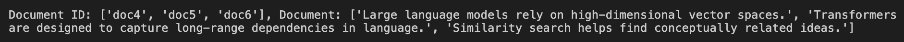
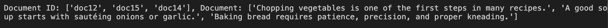
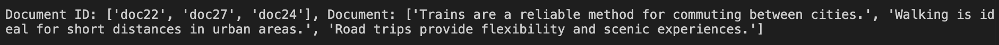
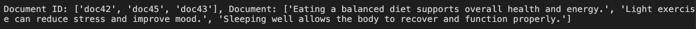
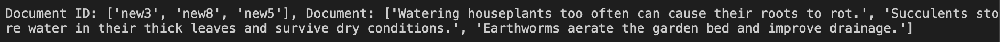
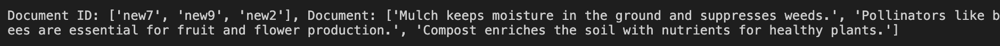

# DOCUMENTO PARA EL PROFE

## Script
- `main.py`

### Queries y Resultados

#### Originales

1. How do computers understand meaning in language?

2. How do people start preparing a meal?

3. What are common ways to move between places?

4. Which activities require coordination and skill?

5. What habits support physical well-being?

#### Propias

1. Why do houseplants die?

2. Which creatures and natural materials help a backyard flourish?

## Oraciones 

#### Originales
- `sentences.txt`

#### Agregadas
- `new_sentences.txt`

## Reflexión

Las dos consultas regresaron solo de las oraciones que yo agregué, los 3 resultados de cada una se relacionan con jardinería y ninguno viene de las originales que son de otras categorias (IA, cocina, viajes, etc.). 
En este caso mis dos consultas se refieren o están relacionados con jardinería, y devuelven conceptos que ienen que ver con este tema (aunque no esté la palabra textual) ya que son conceptos similares o que se acercan más.
